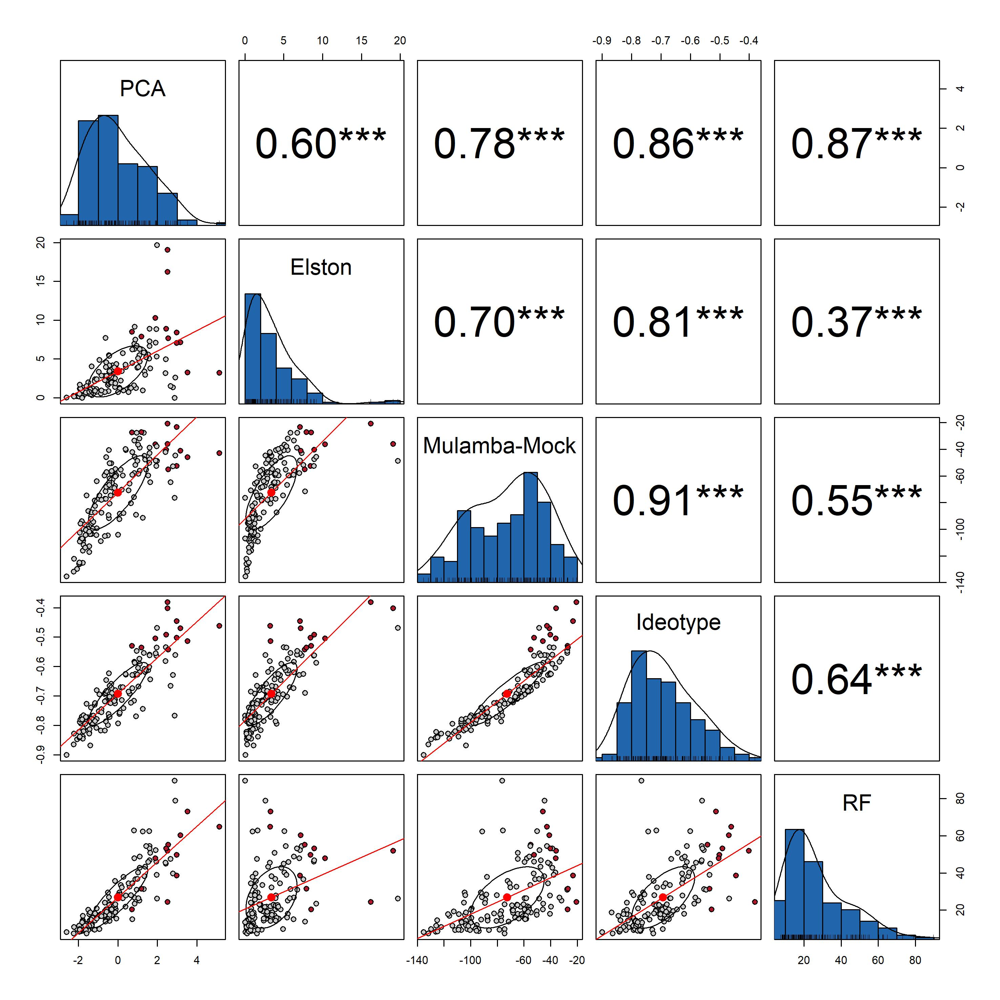

# Project Setup

```{r, echo=FALSE}
#| label: setup
library(factoextra)
library(FactoMineR)
library(vegan)
library(dplyr)
library(purrr)
library(writexl) 
library(cluster)
library(pvclust)
library(lme4)
library(psych)
library(plotly)
library(corrplot)
library(htmlwidgets)
library(devtools)
source('https://inkaverse.com/setup.r')

```

# Data import

```{r, echo=FALSE}
gs <- "https://docs.google.com/spreadsheets/d/14QZQZCEdy0XHK6dqiWQOjy-tU769x_KRhZ-7OyU9phw/edit?gid=1912323931#gid=1912323931" %>% 
  as_sheets_id()

date <- gs %>% 
  range_read(ss = .,sheet = "fb")

```

```{r, echo=FALSE}
 info <- gs %>% 
  range_read(ss = .,sheet ="dictionary")

info <- info |>
  dplyr::mutate(valor = vapply(valor,
                               \(x) if (length(x) == 0) NA_character_ else as.character(x[1]),
                               character(1)))

dic <- info |>
  dplyr::filter(tipo == "cualitativo", !is.na(valor),
                !is.na(categoria_en), categoria_en != "")


# date fb 

fb <- date


for (cod in unique(dic$codigo)) {
  d  <- dic |> dplyr::filter(codigo == cod)
  lk <- setNames(d$categoria_en, d$valor)
  fb[[cod]] <- dplyr::coalesce(unname(lk[fb[[cod]]]), fb[[cod]])
}

mapa <- info |>
  dplyr::distinct(codigo, Acronym) |>
  dplyr::filter(codigo %in% names(fb))

fb <- fb |>
  dplyr::rename(dplyr::any_of(setNames(mapa$codigo, mapa$Acronym)))

fb %>% web_table(scrolly = "400px")

```

# Objective 1: To assess the phenotypic diversity of 144 quinoa accessions (Chenopodium quinoa Willd.) under the agroecological conditions of Ayacucho, Peru, using diversity indices and repeatability estimates of qualitative traits.


## Morphological diversity based on qualitative descriptors

Na = number of accessions per class; Nc = observed classes; Ne = effective number of classes; He = Nei’s diversity index; H′ = Shannon–Weaver index.

```{r, echo=FALSE}

#  detector incoherence 
dif <- fb |>
  dplyr::rename(block = Block, geno = Trat) |>
  dplyr::select(geno, block, PLD:GS, -dplyr::all_of(c("LOD", "NPB", "NLT", "PTL", "MLL", "MLW", "SYP", "PH", "SD", "PLr", "PDr", "GD", "TSW" ))) |>
  tidyr::pivot_longer(-c(geno, block), names_to = "variable", values_to = "valor") |>
  tidyr::pivot_wider(names_from = block, values_from = valor, names_prefix = "Rep_") |>
  dplyr::filter(Rep_I != Rep_II | is.na(Rep_I) != is.na(Rep_II))

# categorical accessions 
quali <- fb |>
  dplyr::rename(block = Block, sub_block = `Sub-block`, Ac = `Ac-`, geno = Trat) |>
  dplyr::select(-dplyr::all_of(c("LOD", "NPB", "NLT", "PTL", "MLL", "MLW", "SYP", "PH", "SD", "PLr", "PDr", "GD", "TSW", "PHS"))) |>
  dplyr::arrange(geno, block) |>
  dplyr::distinct(geno, .keep_all = TRUE) |>
  dplyr::select(-Plot, -block, -sub_block, -rows, -cols, -Ac) |>
  dplyr::mutate(dplyr::across(-c(geno), as.factor))


```

```{r, echo=FALSE}

# 1. Diccionario: acrónimo
dic_q <- info |>
  dplyr::filter(tipo == "cualitativo", !is.na(categoria_en), categoria_en != "") |>
  dplyr::mutate(valor_num = suppressWarnings(as.numeric(valor)))

labs <- dic_q |>
  dplyr::distinct(Acronym, descripcion_en) |>
  tibble::deframe()                                  

ord <- dic_q |>
  dplyr::distinct(Acronym, categoria_en, valor_num)

vars_q <- setdiff(names(quali), "geno")
stopifnot(nrow(quali) == 144, all(vars_q %in% names(labs)))

for (v in vars_q) {
  x   <- as.character(quali[[v]])
  bad <- setdiff(unique(x[!is.na(x)]), ord$categoria_en[ord$Acronym == v])
  if (length(bad)) {
    message("⚠ ", v, ": clases fuera del diccionario -> NA: ", paste(bad, collapse = ", "))
    quali[[v]][x %in% bad] <- NA
  }
}
quali <- quali |> dplyr::mutate(dplyr::across(dplyr::all_of(vars_q), droplevels))

# 3. Frecuencias por clase
sum_q <- function(df, v) {
  df |>
    dplyr::filter(!is.na(.data[[v]])) |>
    dplyr::count(cat_en = as.character(.data[[v]]), name = "Na") |>
    dplyr::mutate(fi = Na / sum(Na)) |>
    dplyr::left_join(
      ord |> dplyr::filter(Acronym == v) |> dplyr::select(cat_en = categoria_en, valor_num),
      by = "cat_en") |>
    dplyr::arrange(valor_num) |>
    dplyr::transmute(`Qualitative trait` = unname(labs[v]),
                     `Phenotypic classes observed` = cat_en, Na, fi)
}
qtb <- purrr::map_dfr(vars_q, \(v) sum_q(quali, v))

# 4. Índices Ne, He, H′ con bootstrap sobre accesiones (SE e IC 95 %)
div_counts <- function(cnt) {
  p <- cnt / sum(cnt); p <- p[p > 0]
  c(Ne = 1 / sum(p^2), He = 1 - sum(p^2), Hp = -sum(p * log(p)) + 0)
}

boot_div <- function(df, v, B = 2000) {
  d   <- df |> dplyr::filter(!is.na(.data[[v]])) |> droplevels()
  cnt <- unclass(table(as.character(d$geno), as.character(d[[v]])))
  est <- div_counts(colSums(cnt))
  bs  <- t(replicate(B, div_counts(
    colSums(cnt[sample.int(nrow(cnt), replace = TRUE), , drop = FALSE]))))
  se  <- apply(bs, 2, sd)
  ci  <- apply(bs, 2, quantile, probs = c(0.025, 0.975))
  tibble::tibble(
    n_acc = nrow(cnt), Nc = ncol(cnt), Ne = est[["Ne"]],
    He = est[["He"]], se_He = se[["He"]], He_lo = ci[1, "He"], He_hi = ci[2, "He"],
    Hp = est[["Hp"]], se_Hp = se[["Hp"]], Hp_lo = ci[1, "Hp"], Hp_hi = ci[2, "Hp"]
  )
}

set.seed(123)
div_tab <- purrr::map_dfr(vars_q, \(v) {
  boot_div(quali, v) |> dplyr::mutate(`Qualitative trait` = unname(labs[v]), .before = 1)
})

# 5. Tabla 
fmt <- qtb |>
  dplyr::left_join(div_tab, by = "Qualitative trait") |>
  dplyr::group_by(`Qualitative trait`) |>
  dplyr::mutate(
    first = dplyr::row_number() == 1,
    Na    = as.character(Na),
    fi    = sprintf("%.2f", fi),
    Nc          = dplyr::if_else(first, as.character(Nc), ""),
    Ne          = dplyr::if_else(first, sprintf("%.2f", Ne), ""),
    `He ± SE`   = dplyr::if_else(first, sprintf("%.2f ± %.2f", He, se_He), ""),
    `He 95% CI` = dplyr::if_else(first, sprintf("%.2f–%.2f", He_lo, He_hi), ""),
    `H′ ± SE`   = dplyr::if_else(first, sprintf("%.2f ± %.2f", Hp, se_Hp), ""),
    `H′ 95% CI` = dplyr::if_else(first, sprintf("%.2f–%.2f", Hp_lo, Hp_hi), ""),
    `Qualitative trait` = dplyr::if_else(first, `Qualitative trait`, "")
  ) |>
  dplyr::ungroup() |>
  dplyr::select(`Qualitative trait`, `Phenotypic classes observed`, Na, fi,
                Nc, Ne, `He ± SE`, `He 95% CI`, `H′ ± SE`, `H′ 95% CI`)

se_  <- \(x) sd(x) / sqrt(length(x))
tq   <- stats::qt(0.975, df = nrow(div_tab) - 1)
ci_t <- \(x) sprintf("%.2f–%.2f", mean(x) - tq * se_(x), mean(x) + tq * se_(x))

mrow <- tibble::tibble(
  `Qualitative trait` = "Mean ± SE", `Phenotypic classes observed` = "", Na = "", fi = "",
  Nc          = sprintf("%.2f ± %.2f", mean(div_tab$Nc), se_(div_tab$Nc)),
  Ne          = sprintf("%.2f ± %.2f", mean(div_tab$Ne), se_(div_tab$Ne)),
  `He ± SE`   = sprintf("%.2f ± %.2f", mean(div_tab$He), se_(div_tab$He)),
  `He 95% CI` = ci_t(div_tab$He),
  `H′ ± SE`   = sprintf("%.2f ± %.2f", mean(div_tab$Hp), se_(div_tab$Hp)),
  `H′ 95% CI` = ci_t(div_tab$Hp)
)

Diversity <- dplyr::bind_rows(fmt, mrow)
Diversity |> web_table(scrolly = "400px")

writexl::write_xlsx(Diversity, "files/STable-1.xlsx")


# 5. Tabla 1 

se_  <- \(x) sd(x) / sqrt(length(x))
tq   <- stats::qt(0.975, df = nrow(div_tab) - 1)
ci_t <- \(x) sprintf("%.2f–%.2f", mean(x) - tq * se_(x), mean(x) + tq * se_(x))

Diversity <- div_tab |>
  dplyr::transmute(
    `Qualitative trait`,
    Nc,
    Ne          = sprintf("%.2f", Ne),
    `He ± SE`   = sprintf("%.2f ± %.2f", He, se_He),
    `He 95% CI` = sprintf("%.2f–%.2f", He_lo, He_hi),
    `H′ ± SE`   = sprintf("%.2f ± %.2f", Hp, se_Hp),
    `H′ 95% CI` = sprintf("%.2f–%.2f", Hp_lo, Hp_hi)
  ) |>
  dplyr::mutate(Nc = as.character(Nc))

mrow <- tibble::tibble(
  `Qualitative trait` = "Mean ± SE",
  Nc          = sprintf("%.2f ± %.2f", mean(div_tab$Nc), se_(div_tab$Nc)),
  Ne          = sprintf("%.2f ± %.2f", mean(div_tab$Ne), se_(div_tab$Ne)),
  `He ± SE`   = sprintf("%.2f ± %.2f", mean(div_tab$He), se_(div_tab$He)),
  `He 95% CI` = ci_t(div_tab$He),
  `H′ ± SE`   = sprintf("%.2f ± %.2f", mean(div_tab$Hp), se_(div_tab$Hp)),
  `H′ 95% CI` = ci_t(div_tab$Hp)
)

Diversity <- dplyr::bind_rows(Diversity, mrow)


writexl::write_xlsx(Diversity, "manuscript/Table-1.xlsx")
```

## Morphological diversity based on quantitative descriptors

```{r, echo=FALSE}


quanti <- fb |> dplyr::rename(
    block     = Block,
    sub_block = `Sub-block`,
    Ac        = `Ac-`,
    geno      = Trat ) |> dplyr::select(
    1:Ac, LOD, NPB, NLT, PTL, MLL, MLW, SYP, PH, SD, PLr, PDr, GD, TSW ) |>
    dplyr::mutate(
    dplyr::across(1:Ac, as.factor),          
    dplyr::across(-(1:Ac), as.numeric)       
  )

exp <- quanti

```

```{r, echo=FALSE}
rslt <- 8:length(exp) %>% map(\(x) {
  
trait <- names(exp)[x]

exp %>% 
   drop_na(trait)%>% 
  H2cal(trait = trait
    , gen.name = "geno"
    , rep.n = 2
    , fixed.model = ~ 0 + (1|block) + (1|sub_block)  + geno
    , random.model = ~ 1 + (1|block) + (1|sub_block) + (1|geno)
    , summary = TRUE
    , emmeans = FALSE 
    , plot_diag = TRUE
    , outliers.rm = FALSE
    )

})
tabsmr <- 1:length(rslt) %>% map(\(x) {
      rslt[[x]][["tabsmr"]] 
      }) %>% 
  bind_rows()

blues <- 1:length(rslt) %>% map(\(x) {
      rslt[[x]][["blues"]] %>% dplyr::select(!matches("smith.w"))
      }) %>% Reduce(function(...) merge(..., all = TRUE
                                        , by = c('geno')), .)

blups <- 1:length(rslt) %>% map(\(x) {
      rslt[[x]][["blups"]] %>% dplyr::select(!matches("smith.w"))
      }) %>% Reduce(function(...) merge(..., all = TRUE
                                        , by = c('geno')), .)

tabsmr %>% web_table(scrolly = "400px")

```


##  Tabla 2: Presents descriptive statistics for the quantitative traits evaluated in the blues dataset. For each trait, the table reports the mean, minimum, maximum, coefficient of variation (CV%) and broad-sense heritability (H²), providing a summary of the central tendency, range, relative variability and genetic determination of the measured characteristics.

```{r, echo=FALSE}

# info %>% dplyr::count(tipo)
# info %>% dplyr::filter(Acronym %in% c("LOD","NPB","NLT","PTL","MLL","MLW","SYP","PH","SD","PLr","PDr","GD","TSW")) %>%
#   dplyr::distinct(Acronym, tipo, descripcion_en)

passport_data <- gs %>% 
  range_read(ss = .,sheet ="passport_data")

# machs en passport-----
blues <- blues %>%
  dplyr::left_join(
    passport_data %>% dplyr::select(Trat, CODIGO),
    by = c("geno" = "Trat")
  ) %>%
  dplyr::mutate(geno = CODIGO) %>%
  dplyr::select(-CODIGO)
#---------------------------

bluesmeans <- blues

bluesmeans %>%
  dplyr::select(c(2:14)) %>%
  dplyr::summarise(dplyr::across(dplyr::everything(), ~ sum(.x < 0, na.rm = TRUE))) %>%
  tidyr::pivot_longer(dplyr::everything(), names_to = "trait", values_to = "n_negative_BLUEs") %>%
  dplyr::filter(n_negative_BLUEs > 0)

rl <- bluesmeans %>%
  dplyr::select(c(2:14)) %>%
  dplyr::mutate(dplyr::across(dplyr::everything(), ~ ifelse(.x < 0, 0, .x))) %>%
  dplyr::summarise(dplyr::across(
    dplyr::everything(),
    list(
      Mean    = ~ round(mean(.x, na.rm = TRUE), 2),
      Min     = ~ round(min(.x, na.rm = TRUE), 2),
      Max     = ~ round(max(.x, na.rm = TRUE), 2),
      `CV(%)` = ~ round(sd(.x, na.rm = TRUE) / mean(.x, na.rm = TRUE) * 100, 2)
    )
  )) %>%
  tidyr::pivot_longer(
    cols = dplyr::everything(),
    names_to = c("Quantitative trait", "stat"),
    names_pattern = "^(.*)_(Mean|Min|Max|CV\\(%\\))$",
    values_to = "value"
  ) %>%
  tidyr::pivot_wider(names_from = stat, values_from = value) %>%
  dplyr::mutate(dplyr::across(Mean:`CV(%)`, ~ formatC(.x, format = "f", digits = 2)))

stopifnot("repeatability" %in% names(tabsmr))

rep_tab <- tabsmr %>%
  dplyr::distinct(trait, .keep_all = TRUE) %>%
  dplyr::transmute(
    `Quantitative trait` = trait,
    Repeatability = sprintf("%.2f", repeatability)
  )

rl <- rl %>%
  dplyr::left_join(rep_tab, by = "Quantitative trait")

stopifnot(nrow(rl) == 13, !any(is.na(rl$Repeatability)))

labs_n <- info |>
  dplyr::filter(Acronym %in% rl$`Quantitative trait`, !is.na(descripcion_en)) |>
  dplyr::distinct(Acronym, descripcion_en) |>
  tibble::deframe()

faltan <- setdiff(rl$`Quantitative trait`, names(labs_n))
if (length(faltan)) stop("Sin descripcion_en en el diccionario para: ", paste(faltan, collapse = ", "))

rl <- rl |>
  dplyr::mutate(`Quantitative trait` = unname(labs_n[`Quantitative trait`]))

rl |> web_table()
writexl::write_xlsx(rl, "manuscript/Table-2.xlsx")

```


# Objective 2: To identify promising accessions using BLUEs of four agronomic traits and to compare five selection approaches.

## Data preparation

The BLUEs of four traits (SYP, TSW, PH, SD) were used for the 144 accessions. Traits were rescaled to 0–1 so that higher values are always better: PH is penalized by its distance to an optimal range (P25–P75) and then inverted. The top 10 % of accessions (n = 14) was retained by each method.

```{r, echo=FALSE}

vars4 <- c("SYP", "TSW", "PH", "SD")


dat <- blues |>
  dplyr::select(geno, dplyr::all_of(vars4))
stopifnot(nrow(dat) == 144, !anyNA(dat))


dat4  <- tibble::column_to_rownames(as.data.frame(dat), "geno")
n_top <- round(0.10 * nrow(dat))

w <- c(SYP = 3, TSW = 2, PH = 1, SD = 1)
w <- (w / sum(w))[vars4]

ph_rng <- quantile(dat$PH, c(0.25, 0.75))
ph_pen <- pmax(ph_rng[[1]] - dat$PH, 0) + pmax(dat$PH - ph_rng[[2]], 0)
mm <- \(x) (x - min(x)) / (max(x) - min(x))

M <- dat |>
  dplyr::mutate(PH = ph_pen, dplyr::across(-geno, mm),
                PH = 1 - PH) |>
  tibble::column_to_rownames("geno")

scores  <- tibble::tibble(geno = dat$geno)
methods <- c("PCA", "Elston", "Mulamba-Mock", "Ideotype", "RF")

top_df <- function(method) {
  scores |>
    dplyr::mutate(Rank = rank(-.data[[method]], ties.method = "min")) |>
    dplyr::arrange(Rank, geno) |>
    dplyr::slice_head(n = n_top) |>
    dplyr::select(Rank, Accession = geno, Score = dplyr::all_of(method)) |>
    dplyr::left_join(dat, by = c("Accession" = "geno")) |>
    dplyr::mutate(Score = signif(Score, 4),
                  dplyr::across(dplyr::all_of(vars4), \(x) round(x, 2)))
}

web_table <- function(x, caption = NULL) {
  DT::datatable(x, rownames = FALSE, caption = caption, filter = "top",
                extensions = "Buttons",
                options = list(pageLength = 14, scrollX = TRUE, dom = "Bfrtip",
                               buttons = c("copy", "csv", "excel")),
                class = "compact stripe hover")
}

plot_top <- function(method, title) {
  top_df(method) |>
    ggplot(aes(reorder(Accession, Score), Score)) +
    geom_col(fill = "#2166AC") +
    coord_flip() +
    labs(x = NULL, y = "Score", title = title) +
    theme_minimal()
}
```

## Principal component analysis

PCA was run on the standardized BLUEs. The first principal component, oriented so that SYP loads positively, was used as the selection score.

```{r, echo=FALSE}
mv <- FactoMineR::PCA(dat4, scale.unit = TRUE, graph = FALSE)

scores$PCA <- as.numeric(mv$ind$coord[as.character(dat$geno), 1] *
                         sign(mv$var$coord["SYP", 1]))

factoextra::fviz_pca_var(mv, repel = TRUE)
top_df("PCA") |> web_table(caption = "Top 10 % accessions by PCA (PC1 score)")
```

## Elston index

The Elston (1963) index was computed with `st4gi::elston()`, as in the F7 selection stage of Lozano-Isla et al. (2023). It is a weight-free index on standardized trait means, so the trait to be minimized (the PH penalty) is multiplied by −1 before the calculation. The index is used here with yield and plant height.

```{r, echo=FALSE}
elston_df <- data.frame(geno = as.character(dat$geno), SYP = dat$SYP,
                        PH = -ph_pen)

elst <- tryCatch(
  st4gi::elston(traits = c("SYP", "PH"), geno = "geno", dfr = elston_df),
  error = \(e) st4gi::elston(elston_df, vars = c("SYP", "PH"), geno = "geno")
)

idx_col <- grep("index", names(elst), ignore.case = TRUE)[1]
scores$Elston <- elst[[idx_col]][match(as.character(dat$geno),
                                       as.character(elst$geno))]

sel <- top_df("Elston")$Accession
dplyr::mutate(dat, Elston = scores$Elston, Top = geno %in% sel) |>
  ggplot(aes(Elston, SYP, color = Top)) +
  geom_point(size = 2, alpha = .8) +
  scale_color_manual(values = c("grey70", "#B2182B")) +
  theme_minimal()

top_df("Elston") |> web_table(caption = "Top 10 % accessions by Elston index")
```

## Mulamba–Mock index

Accessions were ranked for each oriented trait (rank 1 = best) and the ranks were combined as a weighted sum, with weights of 3 for SYP, 2 for TSW and 1 for PH and SD.

```{r, echo=FALSE}
rmat <- apply(M, 2, \(x) rank(-x, ties.method = "average"))
scores$`Mulamba-Mock` <- -as.vector(rmat %*% w)

plot_top("Mulamba-Mock", "Mulamba-Mock (−suma ponderada de rangos)")
top_df("Mulamba-Mock") |> web_table(caption = "Top 10 % accessions by Mulamba-Mock index")
```

## Distance to the ideotype

The ideotype takes the best value of every oriented trait (maximum for SYP, TSW and SD; P25–P75 range for PH). Accessions were scored by the negative weighted Euclidean distance to it.

```{r, echo=FALSE}
scores$Ideotype <- -sqrt(rowSums(sweep((1 - as.matrix(M))^2, 2, w, "*")))

M[as.character(top_df("Ideotype")$Accession), ] |>
  tibble::rownames_to_column("Accession") |>
  tidyr::pivot_longer(-Accession, names_to = "Trait", values_to = "Value") |>
  dplyr::mutate(Trait = factor(Trait, levels = vars4)) |>
  ggplot(aes(Trait, Accession, fill = Value)) +
  geom_tile(color = "white") +
  scale_fill_gradient(low = "white", high = "#2166AC", limits = c(0, 1)) +
  theme_minimal()

top_df("Ideotype") |> web_table(caption = "Top 10 % accessions closest to the ideotype")
```

## Random forest

A random forest (2000 trees) predicted SYP from the other three traits. The out-of-bag prediction was used as the selection score, and permutation importance ranks the traits.

```{r, echo=FALSE}
set.seed(123)
rf <- ranger::ranger(SYP ~ ., data = dat[, vars4], num.trees = 2000,
                     importance = "permutation", seed = 123)
scores$RF <- rf$predictions

tibble::tibble(Variable = names(rf$variable.importance),
               Importance = rf$variable.importance) |>
  ggplot(aes(reorder(Variable, Importance), Importance)) +
  geom_col(fill = "#2166AC") + coord_flip() +
  labs(x = NULL, title = paste0("OOB R² = ", round(rf$r.squared, 3))) +
  theme_minimal()

top_df("RF") |> web_table(caption = "Top 10 % accessions by random forest (predicted SYP)")
```

## Comparison among selection methods

Agreement among methods was assessed with Spearman and Pearson correlations, the overlap of the top 10 %, and the standardized selection differential of each trait. Accessions chosen by at least three methods are reported as consensus selections.

```{r, echo=FALSE}
stopifnot(all(methods %in% names(scores)),
          all(sapply(scores[methods], \(x) all(is.finite(x)))))

ranks <- scores |>
  dplyr::mutate(dplyr::across(dplyr::all_of(methods),
                              \(x) rank(-x, ties.method = "min")))

sp   <- cor(ranks[, methods], method = "spearman")
pe   <- cor(scores[, methods], method = "pearson")
tops <- lapply(methods, \(m) ranks$geno[order(ranks[[m]])][1:n_top]) |>
  setNames(methods)
ov   <- sapply(methods, \(a) sapply(methods, \(b)
                length(intersect(tops[[a]], tops[[b]]))))

sd_tab <- sapply(methods, \(m) {
  sel <- dat$geno %in% tops[[m]]
  sapply(vars4, \(v) (mean(dat[[v]][sel]) - mean(dat[[v]])) / sd(dat[[v]]))
}) |> round(2)

freq <- table(unlist(tops))
consensus <- tibble::tibble(Accession = names(freq), N_methods = as.integer(freq)) |>
  dplyr::filter(N_methods >= 3) |>
  dplyr::left_join(dat, by = c("Accession" = "geno")) |>
  dplyr::mutate(dplyr::across(dplyr::all_of(vars4), \(x) round(x, 2))) |>
  dplyr::arrange(dplyr::desc(N_methods))
```

### Correlación de Spearman entre rankings

```{r, echo=FALSE}
corrplot::corrplot(sp, method = "color", type = "upper", addCoef.col = "black",
                   tl.col = "black", tl.srt = 45, is.corr = FALSE,
                   col = colorRampPalette(c("#B2182B", "white", "#2166AC"))(200),
                   col.lim = c(min(sp), 1))
```

### Correlación de Pearson entre puntuaciones

```{r, echo=FALSE}
sc <- as.data.frame(scores[, methods])
n_sel <- table(factor(unlist(tops), levels = scores$geno))
cons  <- as.integer(n_sel[as.character(scores$geno)]) >= 3

dir.create("files", showWarnings = FALSE)

jpeg("manuscript/Figure_5.jpg", width = 25, height = 25, units = "cm", res = 300)
psych::pairs.panels(
  sc,
  bg       = c("grey80", "#B2182B")[cons + 1],
  hist.col = "#2166AC",
  pch      = 21,
  method   = "pearson",
  stars    = TRUE,
  scale    = FALSE,
  lm       = TRUE
)
invisible(dev.off())


```

```{r, echo=FALSE}
tab_pe <- round(pe, 2) |>
  as.data.frame() |>
  tibble::rownames_to_column("Method")

tab_pe |> web_table(caption = "Pearson correlation between selection scores")
```

### Coincidencias entre las 14 accesiones seleccionadas

```{r, echo=FALSE}
library(patchwork)

# ---- Panel a: traslape top 10 % ----
p_ov <- as.data.frame(as.table(ov)) |>
  ggplot(aes(Var1, Var2, fill = Freq)) +
  geom_tile(color = "white", linewidth = 0.3) +
  geom_text(aes(label = Freq), size = 4.5) +
  scale_fill_gradient(low = "white", high = "#2166AC", name = "Shared") +
  scale_x_discrete(expand = c(0, 0)) +
  scale_y_discrete(expand = c(0, 0)) +
  labs(x = NULL, y = NULL, tag = "a") +
  theme_classic(base_size = 16) +
  theme(
    axis.line         = element_blank(),
    axis.ticks        = element_blank(),
    axis.ticks.length = unit(0, "pt"),
    axis.text.x       = element_text(angle = 45, hjust = 1, vjust = 1,
                                     margin = margin(t = 1)),
    axis.text.y       = element_text(margin = margin(r = 1)),
    panel.border      = element_blank(),
    plot.tag          = element_text(face = "bold", size = 13),
    plot.margin       = margin(8, 8, 8, 8),
    legend.position   = "right"
  )
p_ov
# ---- Panel b: diferencial de selección ----
p_sd <- as.data.frame(as.table(sd_tab)) |>
  dplyr::mutate(Var1 = factor(Var1, levels = rev(vars4))) |>
  ggplot(aes(Var2, Var1, fill = Freq)) +
  geom_tile(color = "white", linewidth = 0.3) +
  geom_text(aes(label = round(Freq, 2)), size = 4.5) +
  scale_fill_gradient2(
    low = "#B2182B", mid = "white", high = "#2166AC",
    midpoint = 0, name = "Std. diff."
  ) +
  scale_x_discrete(expand = c(0, 0)) +
  scale_y_discrete(expand = c(0, 0)) +
  labs(x = NULL, y = NULL, tag = "b") +
  theme_classic(base_size = 16) +
  theme(
    axis.line         = element_blank(),
    axis.ticks        = element_blank(),
    axis.ticks.length = unit(0, "pt"),
    axis.text.x       = element_text(angle = 45, hjust = 1, vjust = 1,
                                     margin = margin(t = 1)),
    axis.text.y       = element_text(margin = margin(r = 1)),
    panel.border      = element_blank(),
    plot.tag          = element_text(face = "bold", size = 13),
    plot.margin       = margin(8, 8, 8, 8),
    legend.position   = "right"
  )
p_sd 

p_final <- p_ov + p_sd +
  plot_layout(ncol = 2, widths = c(1, 1), heights = c(1, 1))


ggsave(
  filename = "manuscript/Figure_4.jpg",
  plot     = p_final,
  width    = 20,
  height   = 15,
  units    = "in",
  dpi      = 600,
  bg       = "white"
)

img <- magick::image_read("manuscript/Figure_4.jpg")
img <- magick::image_trim(img)
magick::image_write(img, "manuscript/Figure_4.jpg", quality = 100)
```


## Top 10 % accessions of all methods

```{r, echo=FALSE}
tab_top <- purrr::map(methods, \(m) as.character(top_df(m)$Accession)) |>
  setNames(methods) |>
  tibble::as_tibble() |>
  tibble::add_column(Rank = seq_len(n_top), .before = 1)

tab_top |> web_table(caption = "Top 10 % accessions by selection method (rank order)")
```

```{r}
#| label: top10-union
#| echo: false
acc     <- sort(unique(as.character(unlist(tops))))
sel_mat <- sapply(methods, \(m) acc %in% as.character(tops[[m]]))

mean_rk <- ranks |>
  dplyr::transmute(Accession = as.character(geno),
                   mean_rank = rowMeans(dplyr::across(dplyr::all_of(methods))))

ticks <- tibble::tibble(Accession = acc) |>
  dplyr::bind_cols(tibble::as_tibble(ifelse(sel_mat, "✓", "")))

tab_union <- tibble::tibble(Accession = acc, N_methods = rowSums(sel_mat)) |>
  dplyr::left_join(mean_rk, by = "Accession") |>
  dplyr::left_join(ticks,   by = "Accession") |>
  dplyr::left_join(dplyr::mutate(dat, geno = as.character(geno)),
                   by = c("Accession" = "geno")) |>
  dplyr::mutate(dplyr::across(dplyr::all_of(vars4), \(x) round(x, 2))) |>
  dplyr::arrange(dplyr::desc(N_methods), mean_rank)

tab_union |> web_table(caption = "Accessions in the top 10 % of at least one method")

```

```{r}
#| label: top14-methods
#| echo: false
vars_imp <- c("PCC", "PD", "GH", "PS")
lab_imp  <- c(PCC = "Grain (pericarp) color", PD = "Panicle density",
              GH = "Growth habit", PS = "Panicle shape")

top14 <- tab_union |>
  dplyr::slice_head(n = n_top)          

quali_cod <- quali |>
  dplyr::mutate(Trat = as.character(geno)) |>
  dplyr::left_join(
    dplyr::mutate(passport_data, Trat = as.character(Trat)) |>
      dplyr::select(Trat, CODIGO),
    by = "Trat") |>
  dplyr::transmute(Accession = as.character(CODIGO),
                   dplyr::across(dplyr::all_of(vars_imp), as.character)) |>
  dplyr::distinct(Accession, .keep_all = TRUE)

tab_quali <- top14 |>
  dplyr::select(Accession, N_methods, dplyr::all_of(vars4)) |>
  dplyr::left_join(quali_cod, by = "Accession")

# Verificaciones
stopifnot(nrow(tab_quali) == 14)
stopifnot(identical(tab_quali$Accession, top14$Accession))
if (anyNA(tab_quali[vars_imp])) {
  warning("Accesiones sin dato cualitativo: ",
          paste(tab_quali$Accession[!complete.cases(tab_quali[vars_imp])],
                collapse = ", "))
}

dir.create("files", showWarnings = FALSE)
tab_quali |> web_table(caption = "Top 14 accessions: quantitative and key qualitative traits")
writexl::write_xlsx(list(Quant_Quali = tab_quali), "files/Table-selected.xlsx")
```

```{r}
#| label: table3-final
#| echo: false
table3 <- top14 |>
  dplyr::select(Accession, N = N_methods,
                dplyr::all_of(methods), dplyr::all_of(vars4)) |>
  dplyr::mutate(Accession = sub("UNSCHLGBVCHQ60405", "UNSCH", Accession))

table3 |> web_table(caption = "Table 3")
writexl::write_xlsx(list(Table3 = table3), "manuscript/Table-3.xlsx")
```

```{r}
#| label: fig-profile
#| echo: false
pal <- c(PCC = "#D9A441", PD = "#2166AC", GH = "#4D9221", PS = "#B2182B")

mk_panel <- function(v) {
  d <- tab_quali |>
    dplyr::count(Class = .data[[v]]) |>
    dplyr::filter(!is.na(Class)) |>
    dplyr::mutate(Class = reorder(Class, n),
                  lab   = sprintf("%d (%.0f%%)", n, n / 14 * 100))

  ggplot(d, aes(n, Class)) +
    geom_col(fill = pal[[v]], width = 0.85) +
    geom_text(aes(label = lab), hjust = -0.15, size = 3.8) +
    scale_y_discrete(expand = expansion(add = c(0, 0.30 * nrow(d))),
                     labels = \(x) stringr::str_wrap(x, 20)) +
    scale_x_continuous(expand = c(0, 0), limits = c(0, 17), breaks = seq(0, 14, 2)) +
    labs(title = lab_imp[[v]], x = "Number of accessions (n = 14)", y = NULL) +
    theme_bw(base_size = 12) +
    theme(plot.title        = element_text(face = "bold", hjust = 0.5, size = 13),
          panel.border      = element_rect(color = "black", fill = NA, linewidth = 0.9),
          panel.grid.major  = element_line(color = "grey90", linewidth = 0.4),
          panel.grid.minor  = element_blank(),
          axis.ticks        = element_line(color = "black"),
          axis.ticks.length = unit(0.18, "cm"),
          axis.text         = element_text(color = "black"),
          axis.title        = element_text(size = 11),
          plot.margin       = margin(8, 12, 8, 8))
}

p_prof <- cowplot::plot_grid(
  plotlist = lapply(vars_imp, mk_panel),
  labels = c("a", "b", "c", "d"), label_size = 18, label_fontface = "bold",
  ncol = 2, align = "hv", axis = "tblr"
)

p_prof
ggsave("files/Figure_1.jpg", p_prof, width = 11, height = 7.5,
       units = "in", dpi = 600, bg = "white")
```

```{r}
#| label: excel
#| echo: false
## Supplementary Excel
dir.create("manuscript", showWarnings = FALSE)

sheets <- c(
  list(Scores        = scores,
       Ranks         = ranks,
       Spearman      = tibble::as_tibble(round(sp, 2), rownames = "Method"),
       Pearson       = tab_pe,
       Top10_overlap = tibble::as_tibble(ov, rownames = "Method"),
       Std_sel_diff  = tibble::as_tibble(sd_tab, rownames = "Trait"),
       Top10_wide    = tab_top,
       Top10_union   = tab_union,
       Top14_Table3  = table3,
       Top14_Quali   = tab_quali,
       Consensus     = consensus),
  setNames(lapply(methods, top_df), paste0("Top_", gsub("-", "_", methods)))
)

writexl::write_xlsx(sheets, "files/Table-3.xlsx")
```


# Final table

Qualitative descriptors (28, acronyms as column names) and quantitative BLUEs (13) for the 144 accessions.

```{r, echo=FALSE}
quali_fin <- quali |>
  dplyr::mutate(geno = as.character(geno)) |>
  dplyr::left_join(
    passport_data |>
      dplyr::mutate(Trat = as.character(Trat)) |>
      dplyr::select(Trat, CODIGO),
    by = c("geno" = "Trat")
  ) |>
  dplyr::mutate(geno = CODIGO) |>
  dplyr::select(-CODIGO)

blues_fin <- blues |>
  dplyr::mutate(
    geno = as.character(geno),
    dplyr::across(-geno, ~ ifelse(.x < 0, 0, .x)),
    dplyr::across(-geno, ~ round(.x, 2))
  )

# passport data (one row per accession, English headers)
pass_fin <- passport_data |>
  dplyr::transmute(
    Accession        = as.character(CODIGO),
    `Collection date` = as.character(`Fecha de colección`),
    Country          = as.character(`País`),
    Department       = as.character(Departamento),
    Province         = as.character(Provincia),
    District         = as.character(Distrito),
    Locality         = as.character(Localidad),
    `Altitude (masl)` = `Altitud (msnm)`
  ) |>
  dplyr::distinct(Accession, .keep_all = TRUE)

final_tab <- quali_fin |>
  dplyr::left_join(blues_fin, by = "geno") |>
  dplyr::rename(Accession = geno) |>
  dplyr::left_join(pass_fin, by = "Accession") |>
  dplyr::relocate(names(pass_fin)[-1], .after = Accession)

n_quali  <- ncol(quali_fin) - 1
n_quanti <- ncol(blues_fin) - 1
n_pass   <- ncol(pass_fin) - 1

stopifnot(
  nrow(final_tab) == 144,
  !anyNA(final_tab$Accession),
  !anyDuplicated(final_tab$Accession),
  n_quali  == 28,
  n_quanti == 13,
  n_pass   == 7,
  ncol(final_tab) == 1 + 7 + 28 + 13,
  !"PHS" %in% names(final_tab)
)

final_tab |> web_table(caption = "Final table: passport data, qualitative descriptors and quantitative BLUEs (144 accessions)")

writexl::write_xlsx(final_tab, "files/Final-table.xlsx")
```

# END
